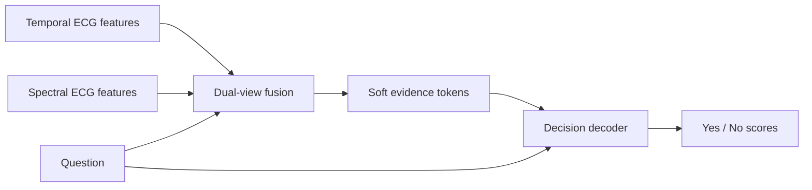

<div align="center">

<h1>ECGJev</h1>

<p><strong>Dual-View ECG Decision Modeling</strong></p>

<p>
  
  
  
</p>

<p>Temporal evidence &middot; Spectral evidence &middot; Question-conditioned decisions</p>

</div>

---

**ECGJev** combines temporal and spectral ECG representations with a learnable fusion module and a language-model decision backend. Given ECG evidence and a question, it scores a fixed set of **Yes / No** options.

We are making the **core source code** publicly available, covering dual-view fusion, descriptor alignment, decision tuning, and inference.

## How It Works

The decision pathway brings together two complementary views of an ECG and conditions the evidence on the question being asked.



The fusion module compresses frozen encoder features into a compact set of soft evidence tokens. These tokens enter the decoder through its multimodal interface, and a fixed option readout produces the decision scores.

## Core Components

| Component | Role | Source |
| :--- | :--- | :--- |
| **Dual-view fusion** | Combines temporal and spectral features using learned queries, cross-attention, and lead, view, and position information. | [models/fusion](src/ecgjev/models/fusion/) |
| **Decision backend** | Connects soft evidence tokens to the StartLux-Decision runtime, manages language LoRA adapters, and maps option logits to Yes / No order. | [backend](src/ecgjev/backend/) |
| **Descriptor alignment** | Aligns ECG evidence with class descriptions during S1. | [train/alignment](src/ecgjev/train/alignment/) |
| **Decision tuning** | Trains question-conditioned fusion and language LoRA adapters during S2. | [train/decision](src/ecgjev/train/decision/) |
| **Prompt and inference utilities** | Build binary questions and return option scores, including multiple questions for the same ECG. | [prompts.py](src/ecgjev/prompts.py) &middot; [inference.py](src/ecgjev/inference.py) |

## Training Stages

**S1 - Descriptor Alignment.** The fusion module learns to align ECG representations with frozen class-description embeddings using supervised, masked multilabel training. Question conditioning is disabled in this stage.

**S2 - Decision Tuning.** The aligned fusion module is trained jointly with language LoRA adapters to answer ECG questions through fixed-option decisions. The base decoder and input encoder features remain frozen.

## Using the Source

Install from the repository root with Python 3.12 or later:

```bash
python -m pip install -e .
```

The release provides the model components and S1/S2 training primitives. Applications supply compatible temporal and spectral features, task questions, training labels, and local decoder weights. Dataset readers, preprocessing, feature encoders, experiment pipelines, and pretrained weights are outside this source release.

Option scores are uncalibrated model outputs. This is research code; a fixed response format does not establish diagnostic accuracy.

## Acknowledgments

The decision runtime incorporates code adapted from **StartLux-Decision**. Third-party attribution and licensing details are provided in [NOTICE](NOTICE) and the bundled [StartLux-Decision license](src/ecgjev/models/decoder/LICENSE.StartLux-Decision).
